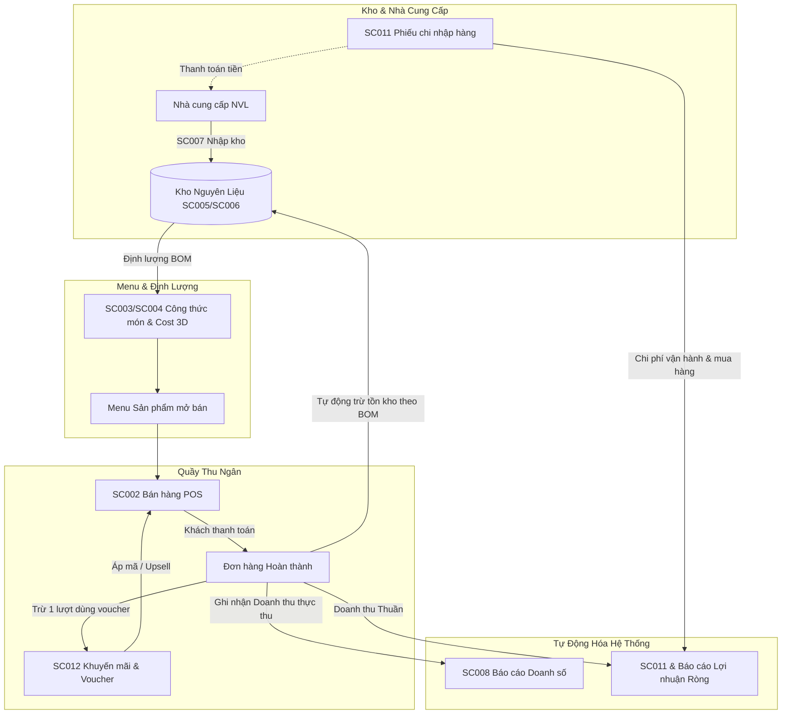
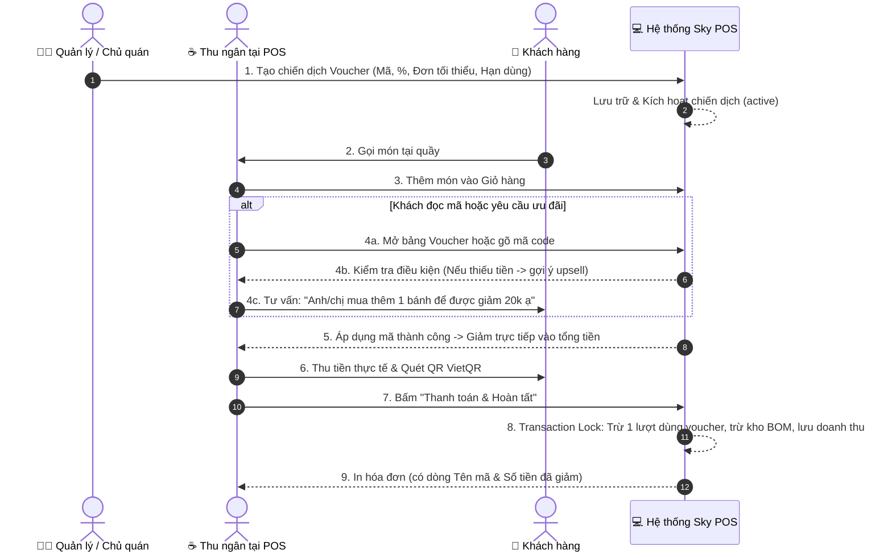

# ☕ SỔ TAY VẬN HÀNH & TÀI LIỆU NGHIỆP VỤ TOÀN DIỆN HỆ THỐNG
## SKY COFFEE MANAGEMENT SYSTEM (POS & ERP F&B)

> **Dành cho:** Khách hàng, Chủ quán (Owner), Quản lý chuỗi (Store Manager), Thu ngân (Cashier), Barista, Kế toán  
> **Phiên bản tài liệu:** 2.0.0 (Master Unified Edition)  
> **Ngày ban hành:** 15/10/2026  
> **Phạm vi:** Trọn bộ 12 màn hình nghiệp vụ (SC001 $\rightarrow$ SC012) tích hợp toàn diện

---

## 📌 MỤC LỤC TỔNG QUAN

1. [Kiến trúc Nghiệp vụ & Vòng tuần hoàn Khép kín F&B](#1-kiến-trúc-nghiệp-vụ--vòng-tuần-hoàn-khép-kín-fb)
2. [Ma trận Phân quyền Tài khoản & Trách nhiệm (RBAC)](#2-ma-trận-phân-quyền-tài-khoản--trách-nhiệm-rbac)
3. [SC001: Dashboard - Trung tâm Chỉ huy & Giám sát Kinh doanh](#3-sc001-dashboard---trung-tâm-chỉ-huy--giám-sát-kinh-doanh)
4. [SC002: Bán hàng tại Quầy (POS), Quản lý Ca, QR Động & Trừ Kho BOM](#4-sc002-bán-hàng-tại-quầy-pos-quản-lý-ca-qr-động--trừ-kho-bom)
5. [SC003 & SC004: Quản trị Menu, Định lượng Công thức (BOM) & Mô phỏng Cost 3D](#5-sc003--sc004-quản-trị-menu-định-lượng-công-thức-bom--mô-phỏng-cost-3d)
6. [SC005 & SC006: Quản trị Kho Nguyên liệu, Định mức An toàn & Cảnh báo Hết hàng](#6-sc005--sc006-quản-trị-kho-nguyên-liệu-định-mức-an-toàn--cảnh-báo-hết-hàng)
7. [SC007: Nhập kho Hàng hóa, Quy cách Đóng gói & Lịch sử Đối soát NCC](#7-sc007-nhập-kho-hàng-hóa-quy-cách-đóng-gói--lịch-sử-đối-soát-ncc)
8. [SC011: Quản trị Chi tiêu, Phiếu chi Dòng tiền & Tái đầu tư (Expenditures)](#8-sc011-quản-trị-chi-tiêu-phiếu-chi-dòng-tiền--tái-đầu-tư-expenditures)
9. [SC012 & SC002: Phân hệ Quản lý Khuyến mãi, Chiến dịch & Voucher Toàn diện](#9-sc012--sc002-phân-hệ-quản-lý-khuyến-mãi-chiến-dịch--voucher-toàn-diện)
   - 9.1. Bản chất Kế toán: Giảm trừ doanh thu vs Chi phí chi tiêu
   - 9.2. Sơ đồ SOP Vận hành Khuyến mãi & Kỹ thuật Upsell tại POS
   - 9.3. Bộ 7 Quy tắc Nghiệp vụ Cốt lõi (BR-01 $\rightarrow$ BR-07)
   - 9.4. Bảng 5 Kịch bản Chiến dịch Marketing Mẫu cho Quán Cafe
   - 9.5. Mẫu hóa đơn in thực tế có ưu đãi
10. [SC008: Báo cáo Bán hàng & Phân tích Doanh số Đa chiều](#10-sc008-báo-cáo-bán-hàng--phân-tích-doanh-số-đa-chiều)
11. [SC009 & SC010: Quản lý Nhân sự, Tài khoản & Phân quyền Bảo mật](#11-sc009--sc010-quản-lý-nhân-sự-tài-khoản--phân-quyền-bảo-mật)
12. [Hệ thống Nguyên tắc Kế toán, Chống Gian lận & Bảo vệ Dữ liệu](#12-hệ-thống-nguyên-tắc-kế-toán-chống-gian-lận--bảo-vệ-dữ-liệu)
13. [Giải đáp Thắc mắc Thường gặp (FAQ Tổng hợp)](#13-giải-đáp-thắc-mắc-thường-gặp-faq-tổng-hợp)

---

## 1. KIẾN TRÚC NGHIỆP VỤ & VÒNG TUẦN HOÀN KHÉP KÍN F&B

Hệ thống Sky Coffee Management được thiết kế theo mô hình **Khép kín 100% (Closed-Loop F&B Operations)**, liên kết chặt chẽ giữa 4 trụ cột: **Kho nguyên liệu $\leftrightarrow$ Menu & BOM $\leftrightarrow$ Bán hàng POS $\leftrightarrow$ Dòng tiền & Báo cáo tài chính**.



### Lợi ích cốt lõi cho Chủ quán:
- **Không bao giờ bị lệch kho:** Bán 1 ly Cà phê Sữa Đá $\rightarrow$ Hệ thống tự động trừ đúng 20g hạt cà phê, 30ml sữa đặc, 1 ly nhựa và 1 ống hút trong kho nguyên liệu.
- **Không thể gian lận tiền:** Đơn hàng đã hoàn thành bị khóa vĩnh viễn, không nhân viên nào có thể sửa hay xóa đơn để bỏ túi riêng.
- **Lợi nhuận ròng thực tế từng ngày:** Biết chính xác hôm nay thu bao nhiêu, chi bao nhiêu, lãi ròng bỏ túi bao nhiêu tiền mặt.

---

## 2. MA TRẬN PHÂN QUYỀN TÀI KHOẢN & TRÁCH NHIỆM (RBAC)

Hệ thống hỗ trợ 4 vai trò với quyền hạn được phân định minh bạch:

| Phân hệ / Màn hình | Admin (Chủ quán) | Manager (Quản lý CH) | Staff (Thu ngân / Barista) | Viewer (Kế toán / Cổ đông) |
| :--- | :---: | :---: | :---: | :---: |
| **SC001: Dashboard Tổng quan** | Toàn quyền | Xem & Lọc chi nhánh | ❌ Không xem | Chỉ xem số liệu |
| **SC002: Bán hàng tại POS** | Toàn quyền | Bán hàng & Duyệt ca | Bán hàng & Kết ca | ❌ Không thao tác |
| **SC003 & SC004: Menu & Định lượng BOM** | Thêm / Sửa / Xóa | Thêm / Sửa | ❌ Không xem | Chỉ xem công thức |
| **SC005 & SC006: Kho Nguyên liệu** | Toàn quyền | Kiểm kho & Cập nhật | Xem tồn kho cảnh báo | Chỉ xem số liệu |
| **SC007: Nhập kho Hàng hóa** | Toàn quyền | Lập phiếu & Đối soát | ❌ Không lập phiếu | Chỉ xem lịch sử |
| **SC008: Báo cáo Doanh số** | Toàn quyền & Xuất CSV | Xem báo cáo chi nhánh | ❌ Không xem | Xem & Xuất CSV |
| **SC009 & SC010: Quản lý Nhân sự** | Toàn quyền tạo/khóa | ❌ Không truy cập | ❌ Không truy cập | ❌ Không truy cập |
| **SC011: Quản lý Chi tiêu Dòng tiền** | Toàn quyền duyệt/xóa | Lập phiếu chi & Xem | Lập phiếu chi lẻ | Xem báo cáo dòng tiền |
| **SC012: Quản lý Voucher & Khuyến mãi** | Toàn quyền thiết lập | Thiết lập & Bật/Tắt | Tra cứu áp mã tại POS | Chỉ xem thống kê |

---

## 3. SC001: DASHBOARD - TRUNG TÂM CHỈ HUY & GIÁM SÁT KINH DOANH
- **Route Frontend:** `/`  
- **Đối tượng:** Chủ quán, Cổ đông, Quản lý cửa hàng.

### 3.1. Các Chỉ số Vàng (KPI Cards):
1. **Doanh thu hôm nay (Today Revenue):** Số tiền thực thu trong ngày, kèm % tăng trưởng so với ngày hôm qua.
2. **Tổng đơn hàng (Order Count):** Số lượng giao dịch thành công.
3. **Số phần/ly bán ra (Items Sold):** Phản ánh công suất phục vụ thực tế của quầy bar.
4. **Cảnh báo Tồn kho Thấp (Low Stock Alert):** Số lượng nguyên vật liệu đã chạm hoặc rớt xuống dưới mức tồn kho tối thiểu, nhấp vào chuyển thẳng sang màn hình Kho để xử lý.

### 3.2. Biểu đồ & Phân tích Trực quan:
- **Biểu đồ Doanh thu (Revenue Trend):** Xem xu hướng doanh thu theo Giờ trong ngày (phát hiện khung giờ cao điểm), theo Ngày trong tuần, hoặc theo Tháng.
- **Tỷ trọng Doanh thu theo Danh mục (Category Pie Chart):** Đo lường nhóm hàng nào đang nuôi sống quán (Cà phê truyền thống, Trà trái cây, Trà sữa, Bánh ngọt, Đồ ăn vặt).
- **Top 5 Sản phẩm Bán chạy nhất (Best Sellers):** Giúp chủ quán quyết định duy trì món "ngôi sao" hoặc nhập thêm nguyên liệu tương ứng.

---

## 4. SC002: BÁN HÀNG TẠI QUẦY (POS), QUẢN LÝ CA, QR ĐỘNG & TRỪ KHO BOM
- **Route Frontend:** `/pos`  
- **Đối tượng:** Thu ngân (Cashier), Barista, Quản lý ca.

### 4.1. Quản lý Ca làm việc & Bàn giao Ca (Shift Handover)
- Quán chia làm 2 ca chuẩn: **Ca sáng (06:00 - 14:00)** và **Ca chiều (14:00 - 22:00)**.
- Banner trên cùng hiển thị rõ nhân viên đang trực và doanh thu tích lũy đúng trong khung giờ ca đó.
- **Quy trình Kết ca:**
  1. Thu ngân hết ca bấm nút **"Kết ca"**.
  2. Hệ thống tổng hợp tức thì: Doanh thu Tiền mặt, Doanh thu Quét QR VietQR, Doanh thu Thẻ ATM/Visa, Tổng tiền voucher đã giảm, và Tổng thực thu.
  3. Thu ngân đếm tiền mặt thực tế trong két, in **Phiếu kết ca bàn giao**, ký tên và đăng xuất để nhân viên ca tiếp theo đăng nhập nhận ca.

### 4.2. Thao tác Tạo đơn & Bán hàng Nhanh
- **Đa Tab Đơn hàng (Multi-tab Draft Orders):** Cho phép mở đồng thời nhiều tab order (Bàn 1, Bàn 2, Khách mang đi) khi khách đang phân vân chọn món mà không làm tắc nghẽn quầy.
- **Tích hợp VietQR Động:** Khách chọn thanh toán QR $\rightarrow$ Hệ thống sinh mã QR ngân hàng có nhúng sẵn: *Số tài khoản quán, Tên chủ tài khoản, Số tiền chính xác của hóa đơn, Nội dung chuyển khoản chứa Mã đơn*. Khách quét 1 giây là xong, không lo khách nhập sai số tiền.
- **Khóa Món Tạm ngừng kinh doanh:** Món hết nguyên liệu hoặc tạm ngừng bán sẽ bị khóa xám, có icon ổ khóa và không thể nhấp thêm vào đơn.

### 4.3. Quy tắc Bảo vệ Doanh thu (Chống Gian lận)
> [!IMPORTANT]
> **Khóa Hủy & Khóa Xóa:**  
> - Đơn hàng đã ở trạng thái **Hoàn thành (`completed`)** sẽ bị **VÔ HIỆU HÓA HOÀN TOÀN** nút Hủy đơn. Backend sẽ từ chối mọi yêu cầu sửa đổi đơn đã thanh toán.
> - Tuyệt đối không có tính năng Xóa đơn hàng trong lịch sử. Toàn bộ dòng tiền bán ra đều được lưu vết vĩnh viễn phục vụ kiểm toán đối soát.

---

## 5. SC003 & SC004: QUẢN TRỊ MENU, ĐỊNH LƯỢNG CÔNG THỨC (BOM) & MÔ PHỎNG COST 3D
- **Route Frontend:** `/products` (Danh sách) & `/products/new` (Tạo mới / Định lượng)  
- **Đối tượng:** Chủ quán, Bếp trưởng / Barista trưởng.

### 5.1. Định lượng Công thức Nguyên liệu (Bill of Materials - BOM)
Mỗi món trong menu bắt buộc phải được gắn công thức gồm ít nhất 1 nguyên vật liệu trong kho:
- **Tự động quy đổi đơn vị tính (Auto Unit Conversion):** Kho quản lý theo `kg` hoặc `lít`, Barista định lượng theo `g` hoặc `ml`. Hệ thống tự động tính toán chính xác giá vốn từng ml si-rô, từng gam bột cà phê.

### 5.2. Tính toán Giá vốn & Tỷ lệ Lãi gộp Dự kiến (Cost & Margin Simulation)
$$\text{Tổng Giá vốn BOM (Cost Price)} = \sum (\text{Định lượng} \times \text{Đơn giá NVL kho})$$
$$\text{Biên Lãi gộp (\% Margin)} = \frac{\text{Giá bán niêm yết} - \text{Giá vốn BOM}}{\text{Giá bán niêm yết}} \times 100\%$$
- **Chuẩn F&B:** Biên lãi gộp đồ uống lý tưởng nên duy trì ở mức **65% - 75%**. Nếu công thức đẩy giá vốn vượt quá 35%, hệ thống sẽ hiển thị cảnh báo để chủ quán điều chỉnh lại giá bán hoặc định lượng.

### 5.3. Trợ lý Smart F&B: Mô phỏng Ly 3D & SOP Barista
- **Mô phỏng Ly 3D:** Hiển thị trực quan từng lớp nguyên liệu xếp tầng trong ly nước.
- **Rada Dinh dưỡng:** Ước tính hàm lượng Calo (Kcal), Caffeine (mg) và Độ ngọt (g đường).
- **Quy trình SOP Pha chế:** Lưu trữ hướng dẫn chuẩn hóa từng bước pha chế cho nhân viên mới xem và làm theo đồng nhất chất lượng toàn chuỗi.

---

## 6. SC005 & SC006: QUẢN TRỊ KHO NGUYÊN LIỆU, ĐỊNH MỨC AN TOÀN & CẢNH BÁO HẾT HÀNG
- **Route Frontend:** `/ingredients` (Danh sách kho) & `/ingredients/create` (Khai báo NVL mới)  
- **Đối tượng:** Quản lý kho, Quản lý cửa hàng, Kế toán kho.

### 6.1. Định mức Tồn kho An toàn & Phân loại Màu cảnh báo
Mỗi nguyên vật liệu đều có cấu hình mức **Tồn kho tối thiểu (`minStock`)**:
- 🟢 **Xanh lá (An toàn - In Stock):** Số lượng tồn kho $\ge 120\%$ mức tối thiểu.
- 🟡 **Vàng (Cảnh báo cần nhập - Low Stock):** Số lượng tồn kho dưới mức tối thiểu nhưng $> 0$. Hệ thống tự động đẩy lên danh sách cảnh báo cần mua hàng.
- 🔴 **Đỏ (Đã hết hàng - Out of Stock):** Tồn kho bằng $0$. Quầy bar không thể tiếp tục pha chế các món sử dụng nguyên liệu này.

### 6.2. Tính Tổng Giá trị Kho (Inventory Asset Value)
Thẻ KPI trên đầu màn hình luôn hiển thị **Tổng giá trị tài sản trong kho (VNĐ)**:
$$\text{Tổng tài sản kho} = \sum (\text{Số lượng tồn} \times \text{Đơn giá vốn bình quân})$$
Giúp chủ quán nắm rõ lượng vốn lưu động đang nằm trong kho là bao nhiêu, tránh tình trạng đọng vốn quá mức.

---

## 7. SC007: NHẬP KHO HÀNG HÓA, QUY CÁCH ĐÓNG GÓI & LỊCH SỬ ĐỐI SOÁT NCC
- **Route Frontend:** `/stock-imports/create`  
- **Đối tượng:** Nhân viên nhận hàng, Quản lý kho, Kế toán.

### 7.1. Chế độ Nhập theo Quy cách Đóng gói Lẻ (Packaging Specs)
Thực tế đi chợ hoặc nhận hàng từ Nhà cung cấp, nguyên liệu thường được đóng trong thùng, bao, lon, bình:
- **Ví dụ nhập Si-rô Đào:** Mua `2 bình`, quy cách `2.1 lít / bình` $\rightarrow$ Tồn kho cộng thêm: $2 \times 2.1 = 4.2 \text{ lít}$.
- **Tính toán Đơn giá 2 chiều:** Nhập tổng tiền hóa đơn mua `420.000đ` $\rightarrow$ Hệ thống tự động chia ngược lại đơn giá vốn $100.000 \text{ đ/lít}$, hoặc nhập đơn giá theo lít $\rightarrow$ tự tính tổng tiền.

### 7.2. Tự động Cập nhật Giá vốn Tồn kho & Lịch sử Nhập hàng
Khi lưu phiếu nhập kho:
1. Số lượng nguyên liệu trong kho được **cộng thêm tức thì**.
2. Đơn giá vốn bình quân (`costPerUnit`) của nguyên liệu được cập nhật mới theo giá nhập thực tế của lô hàng này.
3. Phiếu nhập được lưu vào bảng **Lịch sử nhập kho** phía dưới, hỗ trợ tra cứu theo Mã phiếu (`PNK-xxx`), Nhà cung cấp, Thời gian nhập để đối soát công nợ cuối tháng.

---

## 8. SC011: QUẢN TRỊ CHI TIÊU, PHIẾU CHI DÒNG TIỀN & TÁI ĐẦU TƯ (EXPENDITURES)
- **Route Frontend:** `/expenditures`  
- **Đối tượng:** Chủ quán, Quản lý chi nhánh, Kế toán.

### 8.1. Phân loại 7 Nhóm Chi phí Thực tế trong Quán Cafe
1. **Chi phí Nhập hàng (Stock Imports):** Tiền mua sữa, cà phê, trà, si-rô, đá, bao bì...
2. **Chi phí Vận hành (Utilities & Operation):** Tiền điện, nước máy, mạng Internet, rác thải...
3. **Mặt bằng (Premises):** Tiền thuê nhà, phí ban quản lý tòa nhà hàng tháng.
4. **Lương & Thưởng (Salary):** Lương nhân viên full-time, part-time, thưởng lễ tết.
5. **Tái đầu tư & CSVC (Reinvestment & Equipment):** Mua thêm máy xay, máy pha cà phê mới, ly tách, bàn ghế...
6. **Sửa chữa & Bảo trì (Repair):** Sửa máy lạnh, ống nước quầy bar, thay bóng đèn...
7. **Marketing & Khác:** Chi phí in tờ rơi, chạy quảng cáo Facebook, biển bảng...

### 8.2. Công thức Dòng tiền & Lợi nhuận Ròng Thực Tế
$$\begin{aligned}
\text{Tổng Tiền Thu Về} &= \text{Doanh thu thuần bán hàng tại POS (finalAmount)} \\
\text{Tổng Tiền Chi Ra} &= \text{Chi mua hàng nhập kho} + \text{Các phiếu chi vận hành \& tái đầu tư} \\
\mathbf{\text{Lợi nhuận ròng bỏ túi}} &= \mathbf{\text{Tổng Tiền Thu Về} - \text{Tổng Tiền Chi Ra}}
\end{aligned}$$

> [!TIP]
> **Đính kèm Ảnh Hóa đơn / Chứng từ:**  
> Mọi phiếu chi lớn đều cho phép tải lên ảnh chụp hóa đơn VAT hoặc giấy biên nhận viết tay từ người nhận tiền, đảm bảo tính minh bạch tuyệt đối giữa Quản lý cửa hàng và Chủ quán đầu tư.

---

## 9. SC012 & SC002: PHÂN HỆ QUẢN LÝ KHUYẾN MÃI, CHIẾN DỊCH & VOUCHER TOÀN DIỆN
- **Route Frontend:** `/promotions` (Quản lý chiến dịch) & `/pos` (Thu ngân áp dụng)  
- **Đối tượng:** Chủ quán, Quản lý Marketing, Thu ngân tại quầy.

### 9.1. Bản chất Kế toán: Giảm trừ Doanh thu vs Chi phí Chi tiêu
Nhiều chủ quán băn khoăn: *"Tiền giảm giá voucher có được ghi vào mục Chi tiêu (Phiếu chi) không?"*

| Tiêu chí | Ưu đãi Voucher / Khuyến mãi | Khoản Chi tiêu (Expenditures) |
| :--- | :--- | :--- |
| **Bản chất kinh tế** | **Khoản giảm trừ doanh thu (Contra-Revenue)** | **Dòng tiền chi ra thực tế (Cash Outflow)** |
| **Dòng tiền tại quán** | Không phát sinh dòng tiền ra khỏi két. Quán chỉ đơn giản là *thu bớt đi* so với giá niêm yết của menu. | Rút tiền mặt từ két hoặc chuyển khoản từ tài khoản ngân hàng của quán trả cho nhà cung cấp/đối tác. |
| **Ví dụ thực tế** | Ly trà đào giá 40.000đ, áp mã giảm 10.000đ $\rightarrow$ Khách trả **30.000đ**. Quán nhận 30.000đ. Không có đồng nào bị rút ra chi. | Chi 500.000đ nhập sữa tươi, chi 2.000.000đ tiền điện nước, chi 15.000.000đ tiền mặt bằng. |
| **Xử lý trên hệ thống** | Đã được **khấu trừ trực tiếp** vào Doanh thu thực nhận (`finalAmount`) của đơn hàng. | Lưu trữ trong bảng **Chi tiêu & Dòng tiền** (`expenditures`), có chứng từ hóa đơn đính kèm. |

> [!WARNING]
> **Cảnh báo nghiệp vụ (Tránh tính trừ 2 lần - Double Counting):**  
> Hệ thống **KHÔNG BAO GIỜ** ghi tiền voucher vào mục Chi phí chi tiêu. Nếu đưa vào phiếu chi:
> - *Lần 1:* Khách trả 30k $\rightarrow$ Doanh thu ghi 30k (mất 10k so với giá menu).
> - *Lần 2:* Nếu thêm phiếu chi 10k $\rightarrow$ Lợi nhuận chỉ còn $30k - 10k = 20k$ (Thất thoát ảo 10.000đ trên sổ sách kế toán!).

### 9.2. Sơ đồ SOP Vận hành Khuyến mãi & Kỹ thuật Upsell tại POS



### 9.3. Bộ 7 Quy tắc Nghiệp vụ Cốt lõi (Business Rules)
| Quy tắc | Chi tiết kiểm soát | Mục đích & Ý nghĩa |
| :--- | :--- | :--- |
| **BR-01: Định dạng Mã Code** | Mã voucher tự động chuyển thành **CHỮ HOA**, tự động cắt khoảng trắng thừa. Không được trùng lặp mã đang có trong cơ sở dữ liệu. | Chuẩn hóa dữ liệu, giúp thu ngân gõ không bị phân biệt hoa/thường. |
| **BR-02: Giảm theo % & Trần giảm tối đa** | Khi chọn loại `%`, nếu có cấu hình `maxDiscountAmount`:  <br>$$\text{Số tiền giảm} = \min\left(\text{Tổng đơn} \times \frac{\text{Percent}}{100}, \text{maxDiscountAmount}\right)$$ | Ngăn chặn việc khách đặt đơn tiệc lớn (vài triệu đồng) làm giảm số tiền vượt quá biên lợi nhuận của quán. |
| **BR-03: Kiểm tra Đơn hàng tối thiểu** | Chỉ cho phép áp dụng khi $\text{Tổng tiền món} \ge \text{minOrderAmount}$. | Thúc đẩy gia tăng giá trị đơn hàng trung bình (AOV - Average Order Value). |
| **BR-04: Kiểm soát Hạn sử dụng** | Voucher chỉ có hiệu lực khi: $\text{startDate} \le \text{Thời điểm bán} \le \text{endDate}$. | Quản lý đúng theo từng chiến dịch sự kiện của quán. |
| **BR-05: Kiểm soát Số lượt dùng (Quota)** | Mỗi khi có đơn hàng thanh toán thành công, `usedCount` tăng 1. Khi `usedCount >= usageLimit`, voucher tự động chuyển sang trạng thái hết lượt. | Đảm bảo không bị vượt quá ngân sách marketing đã duyệt. |
| **BR-06: Chống gian lận đồng thời (Concurrency Lock)** | Khi 2 thu ngân tại 2 quầy cùng bấm thanh toán 1 mã còn đúng 1 lượt dùng cuối cùng, hệ thống dùng **Khóa giao dịch CSDL (Pessimistic Lock - `FOR UPDATE`)**. | Thu ngân bấm trước sẽ thành công; thu ngân bấm sau sẽ nhận thông báo mã vừa hết lượt, không bao giờ bị âm lượt dùng. |
| **BR-07: Khóa Hủy đơn & Lưu vết** | Khi đơn hàng đã hoàn tất, không cho phép xóa đơn. Đơn hàng lưu trường `promotionId` và `discountCode` phục vụ đối soát. | Chống nhân viên thông đồng hủy đơn để chiếm đoạt tiền chênh lệch. |

### 9.4. Bảng 5 Kịch bản Chiến dịch Marketing Mẫu cho Quán Cafe
| Tên Chiến dịch | Mã Code | Loại giảm | Giá trị | Trần giảm tối đa | Đơn tối thiểu | Giới hạn lượt | Thời hạn | Mục tiêu chiến lược |
| :--- | :--- | :---: | :---: | :---: | :---: | :---: | :---: | :--- |
| **Mừng Khai Trương Chi Nhánh** | `CHAOSKY` | `PERCENT` | **20%** | 50.000 ₫ | 0 ₫ | 500 lượt | 7 ngày đầu | Thu hút khách trải nghiệm thử quán mới |
| **Ưu Đãi Đồng Đội (Combo Nhóm)** | `TEAMCOFFEE` | `FIXED` | **30.000 ₫** | - | 150.000 ₫ | 200 lượt | Cả tháng | Kích thích khách văn phòng đi theo nhóm từ 3-4 người |
| **Giờ Vàng Buổi Chiều** | `HAPPYHOUR` | `PERCENT` | **15%** | 30.000 ₫ | 60.000 ₫ | 50 lượt/ngày | 14h - 17h hàng ngày | Lấp đầy bàn vào khung giờ vắng khách trong ngày |
| **Tri Ân Khách VIP** | `SKYVIP` | `FIXED` | **50.000 ₫** | - | 200.000 ₫ | 100 lượt | Dài hạn | Giữ chân khách hàng trung thành chi tiêu cao |
| **Đổi Vị Bánh Ngọt Mới** | `SWEETDAY` | `FIXED` | **15.000 ₫** | - | 70.000 ₫ | 150 lượt | Cuối tuần | Đẩy doanh số dòng bánh ngọt ăn kèm cafe |

### 9.5. Mẫu Hóa đơn In Thực tế có Ưu đãi
```text
==========================================
                SKY COFFEE
        Đ/c: Tầng 1, Tòa Sky Tower
------------------------------------------
Hóa đơn: ORD-20261015-0012
Ngày: 15/10/2026 14:30
Thu ngân: Nguyễn Văn A
------------------------------------------
1. Cà phê Muối (Size L)           35.000
2. Trà Đào Cam Sả (Size L)        45.000
3. Bánh Croissant Bơ Tỏi          25.000
------------------------------------------
Tổng tiền hàng:                  105.000 ₫
Ưu đãi (GIAM25K):                -25.000 ₫
------------------------------------------
TỔNG THANH TOÁN:                  80.000 ₫
Thanh toán:                       VietQR
==========================================
   Quý khách đã tiết kiệm được 25.000 ₫!
         Xin cảm ơn & Hẹn gặp lại!
==========================================
```

---

## 10. SC008: BÁO CÁO BÁN HÀNG & PHÂN TÍCH DOANH SỐ ĐA CHIỀU
- **Route Frontend:** `/reports/sales`  
- **Đối tượng:** Chủ quán, Giám đốc kinh doanh, Kế toán tổng hợp.

### 10.1. Dải KPI Đo lường Hiệu suất
1. **Tổng Doanh thu Thuần (Net Revenue):** Tổng tiền thực nhận từ các đơn hàng thành công (đã trừ sạch các khoản voucher giảm giá).
2. **Giá trị Đơn hàng Trung bình (AOV - Average Order Value):** Doanh thu chia cho số đơn. Chỉ số đo lường khả năng upsell của quán.
3. **Chi phí Nguyên liệu (BOM Cost):** Tổng giá vốn các món đã bán ra dựa trên định lượng công thức thực tế.
4. **Lợi nhuận Gộp & Tỷ suất Lãi gộp (% Margin):** Lãi từ hoạt động bán nước thuần túy trước khi trừ các chi phí cố định (mặt bằng, điện nước, lương).

### 10.2. Phân tích Chi tiết 6 Chiều (Tabs)
- **📅 Chi tiết theo Ngày:** Phân tích doanh thu từng ngày trong tháng, so sánh ngày trong tuần (Thứ 2 $\rightarrow$ Chủ Nhật) để bố trí nhân sự phù hợp.
- **🍱 Theo Danh mục:** Tỷ trọng doanh thu và lợi nhuận giữa Cà phê, Trà, Bánh ngọt.
- **🍜 Theo Món ăn:** Bảng xếp hạng chi tiết món nào mang lại nhiều tiền nhất, món nào bán ế để xem xét loại khỏi menu.
- **💳 Phương thức Thanh toán:** Tỷ lệ % giữa Tiền mặt (`Cash`), Quét mã VietQR, Chuyển khoản và Thẻ.
- **🧑‍💼 Theo Nhân viên:** Đánh giá doanh số tạo ra bởi từng thu ngân, phục vụ tính thưởng hoa hồng ca trực.
- **💸 Dòng tiền & Lợi nhuận Ròng:** Báo cáo liên kết sang phân hệ Chi tiêu.

---

## 11. SC009 & SC010: QUẢN LÝ NHÂN SỰ, TÀI KHOẢN & PHÂN QUYỀN BẢO MẬT
- **Route Frontend:** `/users` & `/users/new`  
- **Đối tượng:** Chủ quán (Admin duy nhất có quyền truy cập).

### 11.1. Quản lý Tài khoản & Phân quyền Bảo mật
- Thiết lập thông tin nhân viên: Họ tên, Tên đăng nhập, Email, Số điện thoại, Vai trò (`admin`, `manager`, `staff`, `viewer`).
- **Khóa tài khoản Tức thì (Active / Inactive Toggle):** Khi nhân viên nghỉ việc hoặc có dấu hiệu sai phạm, Chủ quán chỉ cần bấm gạt công tắc sang `Inactive`. Token đăng nhập của nhân viên đó sẽ bị vô hiệu hóa ngay lập tức, ngăn chặn truy cập trái phép vào dữ liệu kinh doanh của quán.

---

## 12. HỆ THỐNG NGUYÊN TẮC KẾ TOÁN, CHỐNG GIAN LẬN & BẢO VỆ DỮ LIỆU

### 12.1. Bộ Quy tắc Vàng Chống Gian lận tại Quán (Anti-Fraud Guidelines)
1. **Nguyên tắc "Đơn Hoàn Thành Là Bất Biến":** Đơn hàng đã thu tiền hoàn tất không được phép sửa, không được phép xóa, không được phép hủy để bảo toàn 100% dòng tiền.
2. **Nguyên tắc "Trừ Kho Kép":** Tồn kho nguyên liệu bị trừ tự động theo công thức ngay khi đơn hoàn tất, không phụ thuộc vào ý chí chủ quan của nhân viên.
3. **Nguyên tắc "Đối Soát Kết Ca":** Cuối mỗi ca, tiền mặt trong két phải khớp chính xác với số liệu trên Phiếu Kết Ca in ra từ hệ thống. Nếu lệch, nhân viên ca đó phải chịu trách nhiệm giải trình.
4. **Phân quyền Tách bạch (Separation of Duties):** Thu ngân chỉ có quyền bán hàng và lập phiếu chi vặt; Quản lý cửa hàng duyệt phiếu chi và kiểm kho; Duy nhất Chủ quán có quyền xem lợi nhuận tổng và quản lý tài khoản nhân sự.

---

## 13. GIẢI ĐÁP THẮC MẮC THƯỜNG GẶP (FAQ TỔNG HỢP)

### Q1: Quán có 2 thu ngân cùng mở máy POS bán hàng, nếu voucher chỉ còn đúng 1 lượt dùng thì có bị dùng lặp không?
> [!NOTE]
> **Trả lời:** **Hoàn toàn không.** Hệ thống Sky Coffee sử dụng cơ chế Khóa bi quan (*Pessimistic Locking `SELECT ... FOR UPDATE`*) trong một Transaction cơ sở dữ liệu. Khi cả 2 thu ngân cùng bấm thanh toán vào cùng 1 tích tắc, hệ thống sẽ xử lý tuần tự: máy nào tới trước 0.001 giây sẽ thanh toán thành công và trừ lượt dùng về 0; máy còn lại sẽ lập tức nhận thông báo *"Voucher vừa hết lượt sử dụng"* và yêu cầu thu ngân chọn hình thức khác.

### Q2: Nếu khách muốn hủy một ly nước sau khi đã áp mã giảm giá thì sao?
> [!NOTE]
> **Trả lời:** Thu ngân chỉ cần bấm giảm số lượng hoặc xóa món khỏi giỏ hàng. Hệ thống POS sẽ tự động kiểm tra lại tổng tiền giỏ hàng ngay lập tức:
> - Nếu số tiền còn lại vẫn đủ điều kiện $\rightarrow$ Giữ nguyên mã và tính lại số tiền giảm (nếu là giảm theo %).
> - Nếu số tiền còn lại bị hụt xuống dưới mức tối thiểu $\rightarrow$ Hệ thống tự động gỡ mã ra và cập nhật lại giá gốc, thông báo rõ ràng trên màn hình để thu ngân không bị nhầm lẫn.

### Q3: Sau khi kết thúc đợt khuyến mãi, tôi có nên xóa hẳn mã đó đi không?
> [!NOTE]
> **Trả lời:** **Không nên xóa hẳn.** Quản lý chỉ cần gạt nút **Công tắc Bật/Tắt** sang `Tắt` (Inactive) hoặc để mã tự động hết hạn theo ngày. Việc giữ lại dữ liệu giúp bạn xem lại lịch sử doanh số và báo cáo hiệu quả chiến dịch của từng thời kỳ. Khi cần chạy lại chiến dịch tương tự (như Giáng Sinh năm sau), bạn chỉ cần bật lại và gia hạn ngày rất tiện lợi.

### Q4: Tiền giảm giá voucher có ảnh hưởng gì tới việc trừ tồn kho nguyên vật liệu không?
> [!NOTE]
> **Trả lời:** **Không hề ảnh hưởng.** Hệ thống trừ tồn kho nguyên vật liệu (BOM) hoàn toàn dựa trên **số lượng ly đồ uống thực tế** được pha chế và bán ra, không phụ thuộc vào việc ly đó được bán giá gốc hay được tặng/giảm giá. Do đó kho nguyên liệu luôn luôn chính xác 100%.

### Q5: Khi nhập một nguyên liệu mới giá cao hơn giá cũ, giá vốn của các món trong menu có tự động tăng không?
> [!NOTE]
> **Trả lời:** **Có.** Hệ thống tính giá vốn món dựa trên `costPerUnit` bình quân mới nhất của nguyên liệu trong kho. Khi giá nhập tăng, giá vốn (Cost Price) của món sẽ tự động cập nhật, giúp chủ quán biết ngay tỷ lệ lãi gộp (% Margin) của món đó có đang bị giảm sút hay không để kịp thời điều chỉnh giá bán.

### Q6: Nếu quán bị mất điện hoặc mất mạng cả buổi, thu ngân ghi chép trên sổ giấy thì hôm sau nhập vào hệ thống thế nào để không bị sai lệch ngày doanh thu?
> [!NOTE]
> **Trả lời:** **Sử dụng Chế độ "Nhập Bán Bù Sự Cố (Retroactive Order Mode)":**
> 1. Đăng nhập bằng tài khoản **Admin** hoặc **Quản lý (Manager)**.
> 2. Trên màn hình POS (`/pos`), bấm nút **"⚡ Nhập bán bù sự cố"**.
> 3. Chọn ngày & giờ bán thực tế hôm qua (sử dụng phím tắt nhanh *"Hôm qua"*), điền lý do sự cố (VD: *"Mất điện ca tối 21/10"*).
> 4. Tích chọn *"Giữ ngày này cho các đơn tiếp theo"* để nhập liên tục toàn bộ xấp hóa đơn giấy.
> 5. Bấm thanh toán: Hệ thống tự động sinh mã đơn theo ngày hôm qua (`DH20261021-XXX`), ghi nhận `orderDate` đúng vào ngày hôm qua, trừ tồn kho nguyên liệu BOM chính xác và tự động cập nhật toàn bộ Báo cáo Doanh số (`/reports/sales`) của ngày hôm qua mà không làm sai lệch doanh thu hay tiền két ca của ngày hôm nay.

---
*Tài liệu này là cẩm nang vận hành chính thức và duy nhất cho toàn bộ nhân sự và nhà đầu tư thuộc Hệ thống Sky Coffee Management.*

